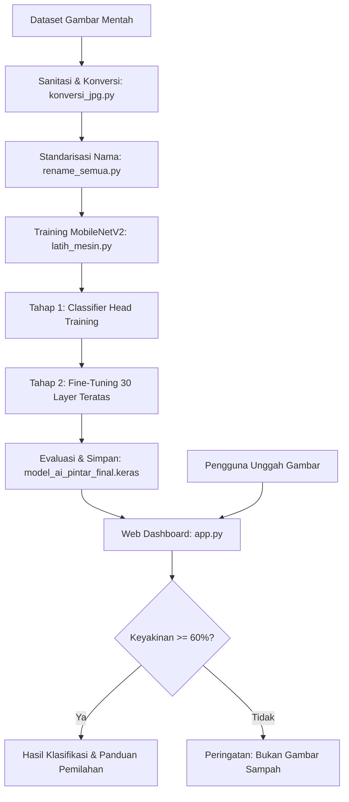

# ♻️ PilahCerdas AI - Sistem Pemilahan Sampah Otomatis Berbasis Deep Learning

[](https://www.python.org/)
[](https://www.tensorflow.org/)
[](https://streamlit.io/)
[]()
[]()

> **Proyek UTS Kecerdasan Buatan (Artificial Intelligence) - Kelompok 1**  
> Solusi cerdas klasifikasi dan pemilahan sampah otomatis secara *real-time* berbasis Computer Vision dan Deep Learning (*Convolutional Neural Network - MobileNetV2*).

---

## 📌 1. Latar Belakang & Ringkasan Proyek

Pengelolaan sampah merupakan tantangan lingkungan yang krusial. Salah satu kendala terbesar di masyarakat adalah rendahnya kepedulian dan pengetahuan mengenai cara memilah sampah secara tepat pada sumbernya. 

**PilahCerdas AI** dirancang sebagai asisten pintar untuk mendeteksi dan mengkategorikan jenis sampah dari citra/gambar yang diunggah pengguna ke dalam 3 kategori utama:
1. **Organik**: Sampah sisa makanan, dedaunan, sisa sayur/buah yang dapat terurai secara alami.
2. **Nonorganik**: Sampah plastik, botol, kaleng, kantong plastik yang membutuhkan proses daur ulang.
3. **Elektronik (E-Waste)**: Komponen elektronik, baterai, kabel, sirkuit yang membutuhkan perlakuan pembuangan khusus (B3).

Model dilatih menggunakan teknik **Transfer Learning** dan **Fine-Tuning** dengan backbone **MobileNetV2** yang sangat ringan, cepat, dan efisien, menghasilkan akurasi evaluasi mencapai **96,09%**.

---

## 🏗️ 2. Struktur Inti Proyek

Berikut adalah gambaran struktur direktori dan file dalam repositori ini:

```plaintext
AI MENDETEKSI GAMBAR/
├── dataset/                     # Folder/link dataset citra (Organik, Nonorganik, Elektronik)
├── app.py                       # Aplikasi web interaktif berbasis Streamlit
├── latih_mesin.py               # Script pipeline training model (Transfer Learning & Fine-Tuning)
├── konversi_jpg.py              # Script pra-pemrosesan: Konversi ke RGB JPEG & hapus file rusak
├── rename_semua.py              # Script penyeragaman nama file dataset (img_1, img_2, ...)
├── model_ai_pintar_final.keras  # Model terlatih Keras format modern (Akurasi ~96.09%)
├── label_mapping.json           # Pemetaan indeks numerik ke nama kategori label
├── grafik_training.png          # Visualisasi grafik performa training & validation
├── requirements.txt             # Daftar dependensi modul Python yang dibutuhkan
├── .gitignore                   # Konfigurasi file yang diabaikan Git (.venv, cache, dll)
└── README.md                    # Dokumentasi lengkap proyek
```

---

## 🔍 3. Penjelasan Detail Setiap Komponen & File

### 1. `app.py` (Antarmuka Pengguna / Web GUI)
- **Teknologi**: [Streamlit](https://streamlit.io/) + TensorFlow + PIL + Pandas
- **Deskripsi**: Merupakan antarmuka visual berbasis web yang responsif dan interaktif.
- **Fitur Utama**:
  - **Sidebar Informasi**: Menampilkan status aplikasi, arsitektur yang digunakan, dan akurasi model.
  - **Uji Model & Upload**: Pengguna dapat mengunggah gambar sampah dalam format `.jpg`, `.jpeg`, atau `.png`.
  - **Validasi Ambang Batas (Confidence Threshold)**: Jika prediksi di bawah **60%**, sistem memberikan peringatan bahwa gambar kemungkinan *bukan sampah*.
  - **Rekomendasi Pembuangan**: Memberikan instruksi tempat sampah yang sesuai berdasarkan hasil deteksi.
  - **Distribusi Probabilitas**: Visualisasi bar chart persentase probabilitas untuk masing-masing kategori sampah.
  - **Riwayat Analisis (History)**: Menyimpan riwayat gambar yang telah diuji selama sesi berlangsung.

### 2. `latih_mesin.py` (Mesin Pelatihan Model Deep Learning)
- **Teknologi**: TensorFlow / Keras, Scikit-Learn, Matplotlib
- **Arsitektur Model**:
  - **Backbone**: `MobileNetV2` (Pre-trained on ImageNet, input shape `128x128x3`).
  - **Data Augmentation**: `RandomFlip("horizontal")` dan `RandomRotation(0.1)` untuk mencegah *overfitting*.
  - **Rescaling**: Normalisasi piksel ke rentang `[-1, 1]`.
  - **Classification Head**: `GlobalAveragePooling2D` -> `Dense(128, ReLU)` -> `Dropout(0.3)` -> `Dense(3, Softmax)`.
- **Strategi Pelatihan 2-Tahap (Two-Stage Training)**:
  - **Tahap 1**: Melatih classifier head dengan base model dibekukan (*frozen*), optimizer Adam (`lr=1e-3`), selama 15 epoch.
  - **Tahap 2**: *Fine-tuning* 30 layer teratas MobileNetV2 (BatchNormalization tetap dibekukan untuk stabilitas), optimizer Adam (`lr=1e-5`), selama 10 epoch.
- **Callbacks**:
  - `EarlyStopping`: Menghentikan proses jika loss validasi tidak membaik setelah 3 epoch berturut-turut.
  - `ReduceLROnPlateau`: Menurunkan learning rate jika performa stagnan.
  - `ModelCheckpoint`: Menyimpan model terbaik ke file `model_ai_pintar_final.keras`.
- **Output Pelatihan**: Mencetak `classification_report` (Precision, Recall, F1-Score) dan menyimpan grafik visualisasi ke `grafik_training.png`.

### 3. `konversi_jpg.py` (Sanitasi & Konversi Format Dataset)
- Memastikan integritas citra dataset dengan:
  - Membuka setiap file gambar dan mengonversinya ke format `RGB`.
  - Menghapus channel transparansi (alpha channel) yang berpotensi menyebabkan error pada TensorFlow.
  - Menyimpan kembali dalam format standar JPEG.
  - Mendeteksi dan menghapus secara otomatis file gambar yang korup atau tidak valid.

### 4. `rename_semua.py` (Standardisasi Nama File)
- Melakukan *batch renaming* pada seluruh file gambar dalam subfolder dataset menjadi format `img_1.jpg`, `img_2.jpg`, dst.
- Berguna untuk menghindari karakter spesial, spasi, atau nama file aneh yang dapat menyebabkan error path pada sistem operasi Windows.

### 5. `label_mapping.json`
- Menyimpan pemetaan indeks array output model ke nama kelas manusia:
  ```json
  [
    "Elektronik",
    "Nonorganik",
    "Organik"
  ]
  ```

### 6. `model_ai_pintar_final.keras`
- File bobot model akhir yang telah terlatih dan dioptimalkan, siap digunakan langsung oleh `app.py` untuk inferensi cepat tanpa perlu pelatihan ulang.

### 7. `grafik_training.png`
- Grafik visual yang menampilkan tren **Accuracy** dan **Loss** (Training vs Validation) dari tahap pelatihan awal hingga tahap *fine-tuning*.

---

## ⚙️ 4. Alur Kerja Sistem (System Workflow)



---

## 🚀 5. Panduan Instalasi & Menjalankan Proyek

### Prasyarat
- Python 3.10 atau versi yang lebih baru
- Git

### Langkah 1: Kloning Repositori
```bash
git clone https://github.com/samsolakmal/uts-ai-memilah-sampah-.git
cd uts-ai-memilah-sampah-
```

### Langkah 2: Buat & Aktifkan Virtual Environment (Disarankan)
- **Windows (PowerShell)**:
  ```powershell
  python -m venv .venv
  .venv\Scripts\Activate.ps1
  ```
- **Linux / macOS**:
  ```bash
  python3 -m venv .venv
  source .venv/bin/activate
  ```

### Langkah 3: Pasang Dependensi
```bash
pip install -r requirements.txt
```

### Langkah 4: Menjalankan Aplikasi Web
Jalankan antarmuka Streamlit:
```bash
streamlit run app.py
```
Aplikasi akan otomatis terbuka di browser pada alamat `http://localhost:8501`.

---

## 🧪 6. Pelatihan Ulang Model (Opsional)

Jika ingin melatih ulang model dengan dataset tambahan:
1. Tempatkan gambar pada direktori `dataset/` dengan struktur:
   ```plaintext
   dataset/
   ├── Elektronik/
   ├── Nonorganik/
   └── Organik/
   ```
2. Jalankan pembersihan format & rename:
   ```bash
   python konversi_jpg.py
   python rename_semua.py
   ```
3. Jalankan pelatihan:
   ```bash
   python latih_mesin.py
   ```

---

## 📊 7. Ringkasan Hasil & Metrik

| Parameter | Keterangan |
|---|---|
| **Base Architecture** | MobileNetV2 (Pretrained ImageNet) |
| **Input Resolution** | 128 x 128 x 3 |
| **Jumlah Kategori** | 3 (Elektronik, Nonorganik, Organik) |
| **Akurasi Validasi** | **~96,09%** |
| **Safety Threshold** | 60% (Validasi deteksi sampah) |
| **Framework** | TensorFlow / Keras 2.15 |

---

## 👥 Pengembang / Tim

- **Mata Kuliah**: Kecerdasan Buatan (Artificial Intelligence) - UTS
- **Tim / Kelompok**: Kelompok 1
- **GitHub**: [@samsolakmal](https://github.com/samsolakmal)
